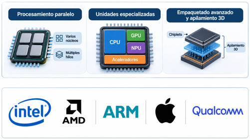
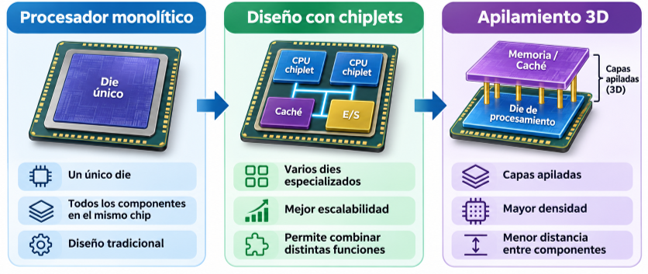
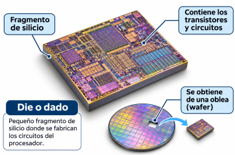
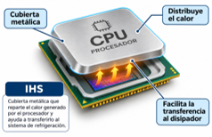
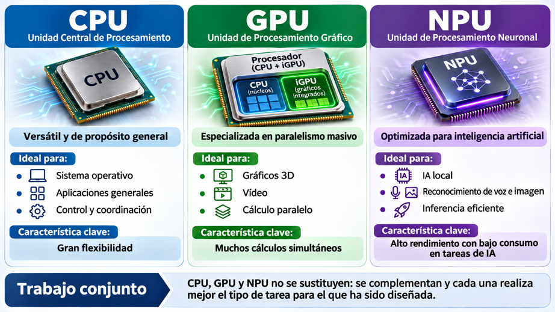
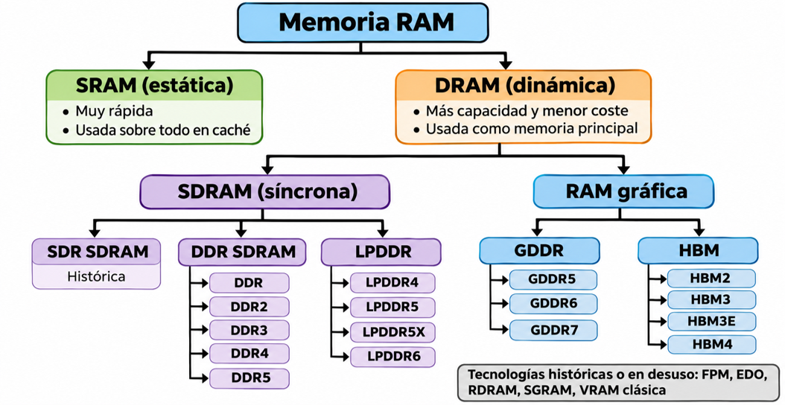

# UT2.6: Componentes hardware - Microprocesadores y memorias

## El microprocesador

```note
El microprocesador es uno de los componentes principales de un sistema informático. Es un circuito integrado que contiene una o varias unidades de procesamiento o CPU, encargadas de interpretar y ejecutar las instrucciones de los programas.
```

Los microprocesadores son los circuitos integrados más complejos, que han ido evolucionando con el paso del tiempo incluyendo más y más transistores con una tecnología de fabricación cada vez más reducida.

Su rendimiento no depende únicamente de la frecuencia de reloj o del número de núcleos. También intervienen factores como la arquitectura interna, el IPC, la memoria caché, el consumo energético y la capacidad de ejecutar tareas en paralelo.

Actualmente, el objetivo de la ingeniería informática es conseguir el mayor rendimiento por vatio a través de un microprocesador, un elevado grado de especialización y el mayor ancho de banda posible.


Actualmente, el objetivo de la ingeniería informática es conseguir el mayor rendimiento por vatio a través de un microprocesador, un elevado grado de especialización y el mayor ancho de banda posible.

Estamos viviendo una época de cambios, de nuevas tecnologías y sobre todo de nuevos microprocesadores y arquitecturas que están consiguiendo aumentar la potencia y rendimiento por cada chip, permaneciendo vigente por el momento la Ley de Moore.



Sin embargo, mejorar el rendimiento ya no consiste únicamente en aumentar la frecuencia o reducir el tamaño de fabricación. Los procesadores modernos combinan diferentes estrategias:
- **Procesamiento paralelo**, mediante varios núcleos y múltiples hilos de ejecución.
- **Unidades especializadas**, como GPU, NPU y otros aceleradores para tareas concretas.
- **Empaquetado avanzado y apilamiento 3D**, que permiten situar distintos chips o memorias muy próximos entre sí.

### Del chip monolítico a los chiplets

1. **Procesador monolítico** Un único die contiene la mayor parte del procesador.
2. **Diseño con chiplets** El procesador se divide en varios dies especializados que se conectan dentro del mismo encapsulado.
3. **Apilamiento 3D** Algunos dies pueden colocarse unos sobre otros para aumentar la densidad y reducir la distancia entre componentes.



### Partes físicas

En cuanto a las **partes físicas** de integra un procesador, observables a simple vista:

- **Encapsulado (package)**: estructura que protege y sirve de soporte a los componentes internos del procesador. Puede contener un único die de silicio o varios dies/chiplets, y proporciona las conexiones eléctricas necesarias con la placa base.
- **Die o dado de silicio**: fragmento de silicio obtenido de una oblea sobre la que se fabrican los transistores y circuitos que forman el procesador. Pueden existir varios dies dentro del mismo encapsulado.
- **IHS (Integrated Heat Spreader)**: cubierta metálica situada sobre el procesador que distribuye el calor generado por los dies y facilita su transferencia hacia el sistema de refrigeración. No todos los procesadores incorporan IHS.
- **Pines o contactos**: proporcionan la conexión eléctrica entre el procesador y la placa base, permitiendo transmitir datos, señales de control y alimentación. Su disposición depende del tipo de encapsulado y socket utilizado.

 

## Características del microprocesador

A continuación, veremos y describiremos sus principales **características**:

- Frecuencia de reloj e IPC.
- Arquitectura e ISA: x86-64, ARM, RISC-V
- Tecnología de fabricación y empaquetado.
- Memoria caché.
- Núcleos del procesador
- Arquitectura de núcleos heterogéneos 
- Nombre comercial.
- SMT/Hyperthreading. 
- TDP y frecuencias Turbo Boost.
- Refrigeración y Overclocking.
- Otras unidades integradas.


### Frecuencia de reloj e IPC

```note
La **frecuencia de reloj** indica el ritmo de funcionamiento del procesador y se expresa en gigahercios (GHz). 
```

Ya sabemos que una mayor frecuencia no implica necesariamente un mayor rendimiento, ya que influyen factores como la arquitectura interna, el número de núcleos, la memoria caché y el tipo de tarea ejecutada.

En los procesadores actuales suelen distinguirse principalmente:
- **Frecuencia base**: velocidad de funcionamiento prevista para cargas sostenidas dentro de determinados límites de consumo y temperatura.
- **Frecuencia Boost** o Turbo: frecuencia superior que el procesador puede alcanzar temporalmente cuando existen margen térmico y energético suficientes.

Además, la comunicación con la RAM, el chipset y otros componentes ya no depende normalmente de un único bus externo como el antiguo **FSB**, sino de diferentes interfaces y enlaces con sus propias frecuencias y velocidades.

```note
El **IPC** (Instructions Per Cycle) indica cuántas instrucciones es capaz de completar un procesador, de media, durante cada ciclo de reloj.
```
Por tanto:
- La **frecuencia** (GHz) indica cuántos ciclos de reloj realiza el procesador por segundo.
- El **IPC** refleja la eficiencia con la que la arquitectura aprovecha cada uno de esos ciclos.
- El **número de núcleos e hilos** determina cuántas tareas pueden ejecutarse en paralelo.

De forma simplificada, el **rendimiento** de un procesador depende de la combinación de:

        Frecuencia × IPC × capacidad de paralelización

Por este motivo, dos procesadores que funcionan a la misma frecuencia pueden ofrecer rendimientos muy diferentes.

En cada nueva generación de procesadores, los fabricantes intentan **aumentar el IPC**, aunque la frecuencia máxima apenas cambie.

### Arquitectura e ISA

```note
La **ISA** (Instruction Set Architecture) o arquitectura del conjunto de instrucciones define las instrucciones que un procesador puede ejecutar, los registros disponibles, los tipos de datos y la forma en que el software se comunica con la CPU.
```

Actualmente destacan tres grandes familias:
- **x86-64**: arquitectura utilizada principalmente en ordenadores personales, estaciones de trabajo y servidores. Es empleada por procesadores de fabricantes como **Intel** y **AMD**.
- **ARM**: arquitectura muy extendida en teléfonos móviles, tabletas y sistemas integrados, y cada vez más presente en ordenadores personales y servidores. Destaca especialmente por su elevada eficiencia energética.
- **RISC-V**: arquitectura de conjunto de instrucciones **abierta y modular**, que permite diseñar procesadores sin depender de una ISA propietaria. Su uso está creciendo en sistemas integrados, investigación y diseños especializados.

👉 Cada ISA necesita software compilado específicamente para ella.

Hoy podemos distinguir entre dos tipos fundamentales de arquitecturas de **64 bits**:

-   **Arquitectura CISC** (*Complex Instruction Set Computer*): utiliza un conjunto amplio de instrucciones, algunas de ellas complejas y de longitud variable. Esto puede requerir una lógica de decodificación más compleja. Ejemplos históricos y actuales de arquitecturas CISC son Motorola 68000 y la familia x86/x86-64, utilizada por procesadores de Intel y AMD.

 -   **Arquitectura RISC** (*Reduced Instruction Set Computer*): Utiliza instrucciones más simples y regulares, con un número más limitado de ellas. Se ejecutan más instrucciones en menor tiempo. Ejemplos de arquitecturas RISC son PowerPC, ARM y RISC-V. ARM se utiliza en numerosos procesadores y SoC, como Snapdragon, Exynos, Apple Silicon o Kirin. RISC-V, además, destaca por ser una ISA abierta y modular.
 


| **Aspecto** | **CISC** | **RISC** |
|---|---|---|
| **Conjunto de instrucciones** | Amplio, con instrucciones de complejidad y longitud variables. | Más regular, con instrucciones generalmente más sencillas. |
| **Transistores y complejidad** | Históricamente podía necesitar más circuitería dedicada a interpretar instrucciones complejas. | Históricamente permitía dedicar una mayor parte del diseño a registros y unidades de ejecución. |
| **Eficiencia energética** | Las primeras arquitecturas CISC podían requerir más trabajo interno para determinadas instrucciones. | La eficiencia energética siempre ha sido uno de los puntos fuertes de esta arquitectura. |
| **Rendimiento** | Las instrucciones complejas pueden realizar varias operaciones en una sola instrucción del programa. | Las instrucciones simples y regulares facilitan técnicas como *pipeline* y ejecución paralela. |
| **Coste y diseño** | Diseño complejo. La compatibilidad con instrucciones antiguas también puede aumentar la complejidad del diseño. | Una ISA más regular puede simplificar ciertas partes del diseño, aunque los procesadores RISC actuales también son complejos. |
| **Ejemplos actuales** | x86-64: Intel, AMD. | ARM, como Snapdragon, Exynos y Apple Silicon, y RISC-V. |

Aunque tradicionalmente se diferenciaban claramente, hoy las fronteras entre CISC y RISC se han ido difuminado y se puede hablar de **arquitecturas híbridas**:

-   Los procesadores **x86 modernos** traducen internamente las instrucciones CISC a microinstrucciones tipo RISC que pueden ejecutarse de forma paralela.

-   Los procesadores **ARM modernos** incorporan instrucciones más complejas, ejecución fuera de orden, múltiples unidades de ejecución, grandes memorias caché e instrucciones especializadas.

Hoy ya no se puede hablar de CISC o RISC puros, sino de procesadores híbridos, que buscan combinar lo mejor de ambos mundos: la compatibilidad de CISC con la eficiencia y simplicidad de RISC.

La arquitectura **RISC-V** es especialmente interesante en la actualidad, por ser abierta (open source) y en rápida expansión en ámbitos educativos, de investigación y diseño de hardware libre.

### Tecnología de fabricación

La tecnología de fabricación describe el proceso utilizado para construir los transistores y circuitos que forman un procesador. Tradicionalmente, estos procesos se han identificado mediante valores expresados en **nanómetros** (nm). Una tecnología de fabricación más avanzada permite disponer de mayor **densidad** de transistores y menor **consumo** energético.

Que un microprocesador tenga una tecnología de **3 nanómetros** no quiere decir que todas las puertas lógicas tengan ese tamaño, sino que tendrán un tamaño aproximado a 3 nm.


### Memoria caché

Una de las características de los microprocesadores es la **memoria caché**, muy rápida y de tamaño limitado, tal y como vimos en unidades anteriores.

Existen diversos niveles de caché denominados **L1**, **L2** y **L3**:

-   **La caché L1** funciona a la máxima velocidad y es la más cercana al núcleo del procesador. Su tamaño se mide en KB (*64-128KB*). Hay tantas caché L1 como núcleos del microprocesador.
-   **La caché L2** es algo más lenta que la L1 y está conectada al microprocesador mediante su bus trasero. Tamaño de unos pocos MB (*1MB*)
-   **La caché L3** es más lenta que la L2, pero de mayor capacidad. Se comparte entre los núcleos y su tamaño se mide en varios MB (*8-64MB*)


### Núcleos del procesador

```note
Un núcleo (core) es una unidad de procesamiento capaz de ejecutar instrucciones de forma independiente dentro de un procesador.
```

Los procesadores más antiguos eran **single core** es decir, de un único núcleo. Los actuales van más allá (dual-core, quad-core, octa-core…).  

Disponer de varios núcleos permite ejecutar varias tareas de forma simultánea y mejorar el rendimiento de aplicaciones capaces de trabajar en paralelo.

Sin embargo, **duplicar el número de núcleos no implica duplicar automáticamente el rendimiento**, ya que depende de la capacidad del software para aprovecharlos.


### Arquitectura de núcleos heterogéneos 
 
Los procesadores con arquitectura **ARM** introdujeron una tecnología de núcleos heterogéneos llamada big.LITTLE. Esta arquitectura combina dos tipos de núcleos (cores) dentro de un mismo procesador, organizados en grupos que se activan según las necesidades de rendimiento o eficiencia energética.

- El grupo de **alto rendimiento**, que está compuesto por los núcleos más potentes se encarga de las tareas más pesadas, como videojuegos, o uso multimedia intensivo, aunque, consume mucha más energía. 
- El grupo de **alta eficiencia** que actúa en aquellas situaciones en las que no es necesaria tanta potencia o en segundo plano y prioriza un consumo energético bajo.

Esta combinación permite adaptar el procesador a la carga de trabajo de cada momento, lo que resulta ideal para dispositivos móviles y portátiles.

El resto de fabricantes replicó esta arquitectura en sus procesadores con otros nombres. Por ejemplo, Intel con los P-cores (Performance cores) y E-cores (Efficient cores).


### Nombre comercial

Los fabricantes utilizan una nomenclatura comercial para identificar las diferentes familias y modelos de procesadores. El nombre suele aportar información sobre la familia, generación o rendimiento de dicho procesador, pero no es objeto de estudio al ser demasiado amplio.

Veamos un ejemplo de un modelo de Intel y el significado de sus siglas:


-   **Intel Core**: Nos indica la arquitectura a la que pertenece
-   **i7**: Familia de procesadores dentro de Intel Core. Esta familia tiene 8 núcleos
-   **10**: El primer número siempre indica la generación, en este caso, la décima.
-   **65**: indica que está en la zona alta en cuanto a rendimiento, dentro de la gama i7
-   **K**: esta letra significa que la CPU no tiene la velocidad bloqueada (Unlocked), así que se puede hacer overclocking para aumentar su rendimiento. Está pensado para juegos.

### SMT/HyperThreading

```note
**SMT** (Simultaneous Multithreading) es una técnica que permite que un mismo núcleo físico gestione varios hilos de ejecución de forma simultánea.
```

La idea de SMT es aprovechar las unidades del núcleo para que no se queden libres, y mantenerlas siempre ocupadas, dándoles hilos de instrucciones a la vez en distintos momentos (por ejemplo, mientras una decodifica otra ejecuta una operandos en la ALU). 

Un **núcleo físico** puede presentarse al sistema operativo como varios procesadores lógicos y un **hilo lógico** no equivale a un núcleo físico adicional, ya que ambos comparten recursos.

El nombre comercial de dicha tecnología es **HyperThreading** en Intel o **SMT** en AMD. 


 


### TDP y frecuencias Turbo Boost

```note
El **TDP** (Thermal Design Power) es un valor de referencia relacionado con la cantidad de calor que el sistema de refrigeración debe ser capaz de disipar durante su funcionamiento.
```

Se expresa en **vatios (W)**, pero no representa necesariamente el consumo eléctrico máximo real del procesador.

Los procesadores modernos pueden **modificar dinámicamente** su frecuencia según la carga de trabajo, la temperatura y los límites de potencia.
- **Frecuencia base**: velocidad de funcionamiento de referencia del procesador.
- **Frecuencia Turbo o Boost**: frecuencia superior que puede alcanzarse temporalmente cuando existen margen térmico y energético suficientes.


### Refrigeración y Overclocking

Debido a la enorme velocidad que alcanza la CPU y que el paso de corriente genera calor es necesario **refrigerar** el procesador. Existen diversas formas de hacer esto:

-   Mediante refrigeración pasiva (superficies metálicas)
-   Mediante refrigeración activa (ventiladores)
-   Mediante refrigeración líquida.


El **overclocking** es la acción de aumentar la velocidad del reloj de un componente de un ordenador aumentado para ello su voltaje.

Para *overclockear* un procesador es necesario aumentar su voltaje, lo que se conoce como un aumento del **Vcore**, lo cual aumentará su frecuencia o GHz.

El overclocking puede suponer una pérdida de estabilidad o acortar la vida útil del componente e incluso fundirlo si no se lleva bien a cabo.

### Otras unidades integradas 


Con el paso del tiempo, los microprocesadores han dejado de ser únicamente una CPU encargada de ejecutar instrucciones y operaciones lógicas.

Hoy en día, incorporan en el mismo chip otros componentes especializados que mejoran el rendimiento general y la eficiencia energética del sistema.

- Muchos procesadores actuales incluyen una **unidad gráfica integrada** (Integrated Graphics Processing Unit o iGPU). Esta unidad permite realizar tareas de procesamiento gráfico sin necesidad de una tarjeta gráfica dedicada (GPU independiente).
- Las **NPU** (Neural Processing Unit) son un tipo de coprocesador especializado en ejecutar operaciones de **inteligencia artificial** y aprendizaje automático. El rendimiento de estas unidades suele expresarse en **TOPS** (Trillions of Operations Per Second), es decir, billones de operaciones por segundo.
- Motores multimedia: sirven para acelerar tareas como codificación y decodificación de vídeo.
- **Funciones de seguridad**: algunos procesadores incorporan mecanismos de seguridad y módulos de confianza integrados o por firmware, como **TPM/fTPM**.



## SoC (System on a Chip)

```note
Las siglas de SoC (System on a Chip) se refieren a un sólo chip que integra en su encapsulado varios de los componentes principales necesarios para el funcionamiento de un sistema.
```

En el SoC de un microprocesador, especialmente en aquellos de dispositivos como teléfonos móviles, tabletas o consolas, donde se intenta concentrar su contenido, suelen integrar varios de los componentes fundamentales de un ordenador, como la CPU, un procesador gráfico integrado (IGP, diferente y sobre todo menos potentes que las GPU de tarjetas gráficas dedicadas), memoria, puertos de entrada salida, un módem, un DSP o chips dedicados a la seguridad.


Los **SoCs** han emergido de forma espectacular con la revolución móvil y con los diseños de ARM y desarrollos de fabricantes como Qualcomm, MediaTek, Apple, Samsung o Huawei, que han sacado mucho partido de este concepto para lograr procesadores que en realidad son mucho más que eso. También AMD para RISC.

Algunas de las principales familias de **SoC** utilizadas actualmente son:
- Apple Silicon: integra CPU, GPU, Neural Engine, controladores y memoria unificada en los equipos Mac y otros dispositivos de Apple.
- Qualcomm Snapdragon: muy utilizado en smartphones y también en portátiles ARM.
- Samsung Exynos: familia de SoC empleada principalmente en dispositivos móviles.
- MediaTek Dimensity: utilizada en smartphones y otros dispositivos móviles.
- SoC para sistemas embebidos: utilizados en dispositivos IoT, automoción, electrónica, etc. 


## La memoria RAM

```note
La memoria RAM (Random Access Memory) o memoria de acceso aleatorio, es la memoria principal de trabajo de un dispositivo, donde se almacenan de forma temporal el SO, los programas y los datos que se están utilizando en ese momento.
```

Se trata de una memoria volátil y se denomina de **acceso aleatorio** porque se puede leer o escribir directamente en cualquier posición de memoria, sin necesidad de recorrer previamente las posiciones anteriores, con tiempos de acceso del mismo orden de magnitud.


Esquema de **celda** de una memoria básica Esquema de una memoria RAM en una **matriz** de 4x4 celdas

 

### Memoria estática SRAM

La memoria **SRAM** *(Static Random Access Memory)* es uno de los tipos clásicos de memoria semiconductor, se utilizó desde las primeras generaciones de memorias electrónicas y actualmente en las memorias caché de dispositivos.

Almacena cada bit mediante un circuito formado por varios transistores.

Sus principales características son:
- Muy **alta velocidad** y baja latencia.
- Utiliza **varios transistores por bit**, por lo que presenta menor densidad que la DRAM.
- Su fabricación es **costosa** y resulta menos adecuada para memorias de gran capacidad.
- Por su velocidad y características, se utiliza principalmente como **memoria caché** de los procesadores y en buffers internos de alta velocidad.


### Memoria dinámica DRAM

La memoria **DRAM** *(Dynamic Random Access Memory)* es el otro tipo básico de memoria RAM, que almacena cada bit mediante un pequeño condensador y un transistor.

Este tipo de memoria necesita un **refresco periódico (dinámico)** de los datos en su interior ya que tienen **condensadores** que periódicamente se van descargando.

Sus principales características son:
- Tiene **mayor densidad** que la SRAM, por lo que permite almacenar más información ocupando menos espacio.
- Su fabricación es **más económica**, lo que es adecuada para memorias de gran capacidad.
- Es **más lenta** que la SRAM y presenta una mayor latencia.

Constituye la base de la memoria RAM principal utilizada en los ordenadores actuales. 


### Memoria dinámica SDRAM

La memoria **SDRAM** *(Synchronous Dynamic Random Access Memory)* es un tipo de memoria DRAM que **sincroniza** sus operaciones con una **señal de reloj**.

Sus principales características son:
- Sigue siendo una memoria **DRAM**, por lo que necesita refresco periódico.
- Utiliza una señal de reloj para organizar las operaciones de lectura y escritura.
- Permite realizar transferencias de forma más eficiente y predecible.
- Constituye la base de las memorias **DDR SDRAM** utilizadas actualmente.


### Memoria dinámica SDRAM DDR

La memoria **SDRAM DDR** *(Double Data Rate SDRAM)* es el tipo de memoria que se estandarizó, y a partir de aquí surgieron sus generaciones siguientes: *DDR2, DDR3, DDR4 y DDR5*.

Opera de la misma manera que la SDR SDRAM solo que el **doble de rápida**, es decir, es capaz de realizar dos instrucciones de lectura y dos de escritura por cada ciclo de reloj, utilizando tanto el flanco de subida como el de bajada de la señal.

Cada nueva generación ha ido aumentando también su **eficiencia energética**, además de introducir mejoras internas en la organización de dicha memoria.


La velocidad de las memorias DDR suele expresarse en MT/s (megatransferencias por segundo).
Es importante diferenciar:
- **MHz**: indica la frecuencia del reloj.
- **MT/s**: indica cuántas transferencias de datos se realizan por segundo.

Como las memorias DDR (Double Data Rate) realizan dos transferencias por cada ciclo de reloj, la tasa de transferencia es aproximadamente el doble de la frecuencia del reloj.

Por ejemplo:
*DDR5-6000 → 6000 MT/s → reloj aproximado de 3000 MHz*
Por tanto, aunque comercialmente se hable muchas veces de 6000 MHz, técnicamente lo correcto es hablar de 6000 MT/s.

### Memoria dinámica LPDDR

La **LPDDR** (*Low Power Double Data Rate*) es una familia de memoria DRAM diseñada para ofrecer **bajo consumo energético** y altas tasas de transferencia.

Se utiliza principalmente en:
- Smartphones y tablets
- Ordenadores portátiles
- SoC y sistemas integrados

Sus principales características son:
- Menor consumo que la DDR convencional.
- Diseñada para reducir el gasto energético cuando el sistema está en reposo o poca carga.
- Integración frecuente muy cerca del procesador o directamente en el mismo encapsulado.
- Altas velocidades de transferencia con un consumo reducido.

Entre sus generaciones se encuentran **LPDDR4**, **LPDDR5** y LPDDR5X.

### Otras memorias DRAM

**GDDR**

Memoria DRAM optimizada para ofrecer **alto ancho de banda**, utilizada principalmente en tarjetas gráficas y tareas de cálculo paralelo.
Las generaciones actuales incluyen GDDR6 y GDDR7.

**HBM**

Memoria de muy alto ancho de banda formada por **varios dies apilados verticalmente** y situados muy cerca del procesador.
Se utiliza especialmente en aceleradores de IA, supercomputación y sistemas HPC.
Generaciones recientes incluyen HBM3E y HBM4.


### SRAM vs DRAM


### Canales de memoria  

Un **canal de memoria** es la vía de comunicación entre el controlador del procesador y la memoria RAM.

Utilizar varios canales permite realizar más transferencias de datos simultáneamente y, por tanto, **aumentar el ancho de banda** disponible.

Las configuraciones más habituales son:
- **Single Channel**: utiliza un único canal de memoria.
- **Dual Channel**: utiliza dos canales simultáneamente
- **Quad Channel**: utiliza cuatro canales y se encuentra en plataformas de altas prestaciones o servidores.


Para aprovechar estas configuraciones:
- Los módulos deberán tener la **misma capacidad** y preferiblemente la misma marca y modelo.
- Si se combinan memorias de distinta velocidad, el sistema funcionará a la del módulo más lento.


