# UT2.7: Componentes hardware - Conectores, gráfica, almacenamiento, periféricos 

## Conectores


### Transmisión de la información

#### Transmisión de datos cableado en serie

- Se envían datos bit a bit a una frecuencia convenida.
- Se simplifica el control de la transmisión.
- Los buses o puertos serie suelen funcionar a una velocidad mayor que el bus o puerto paralelo equivalente, ya que pueden aumentar su frecuencia.
- Son ejemplos de conexiones serie USB, SATA, PCI Express y Ethernet.


#### Transmisión de datos cableado en paralelo

- Se envían varios bits de forma simultánea.
- Al aumentar la frecuencia puede producirse distorsión de señal entre las líneas del cableado.
- Los datos deben salir y llegar a la vez para poder reconstruirse, lo que plantea problemas de sincronización.
- Resulta adecuado para distancias cortas, pero requiere un cableado más aparatoso y costoso.
- Son ejemplos los buses de memoria RAM y los antiguos puertos de impresora.


## Conectores internos

Son los **conectores internos** de corriente y de datos que se utilizan en una placa o entre componentes dentro de la carcasa.

Existen los siguientes tipos de conectores internos:

- **Conectores de corriente**: alimentación ATX o EPS de la placa base.
- **Conectores de cabecera** (*headers*): conectan botones, LED y ventiladores.
- **Conectores de datos**: permiten intercambiar información entre dispositivos, como SATA y M.2.
- **Ranuras de expansión**: permiten incorporar tarjetas adicionales, como las conectadas mediante PCI Express.

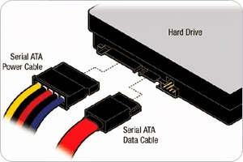 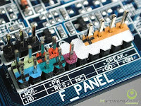 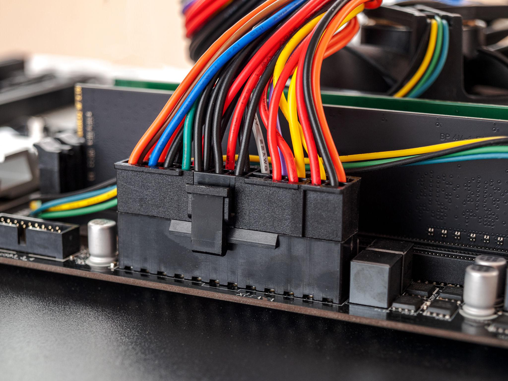 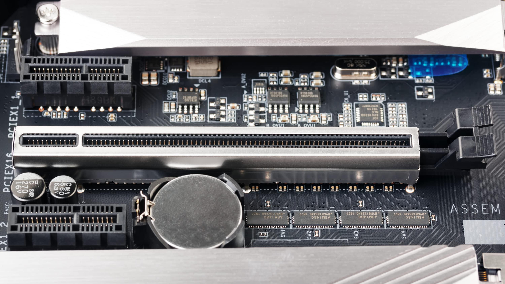

## Conectores externos

Los **conectores externos** o periféricos son los que nos solemos encontramos en la parte trasera o frontal de un equipo. La gran mayoría de dispositivos que se conectan a estos puertos son los periféricos, como es el caso de los monitores, impresoras, teclados, ratones, etc.

Permiten transmitir datos, audio y vídeo, establecer comunicaciones de red y, en algunos casos, suministrar alimentación eléctrica. Pueden encontrarse en la parte frontal, trasera o lateral del equipo.

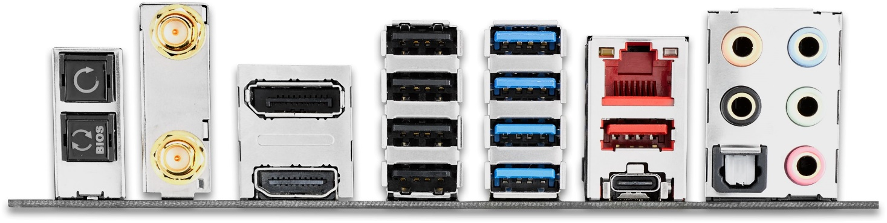

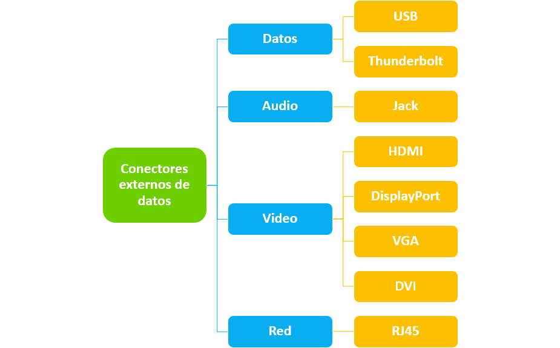

### USB

El **USB** (*Universal Serial Bus*) es el estándar que define los conectores, cables y protocolos usados para conectar, comunicar y proveer de alimentación eléctrica entre computadoras, periféricos y dispositivos electrónicos. Su primera especificación se publicó en 1996. Actualmente, USB 3.2 está muy extendido y ofrece velocidades de hasta 20 Gbit/s, mientras **USB4** continúa implantándose en nuevos equipos.

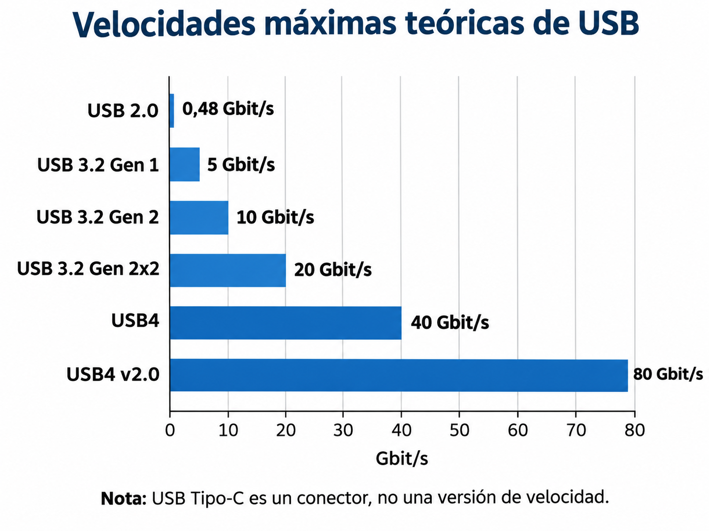

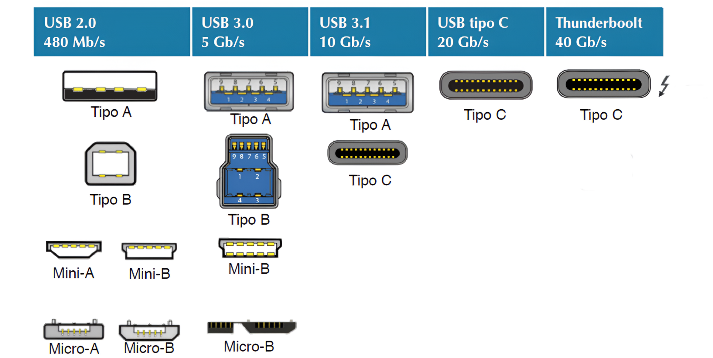

Tipos de conectores USB según su factor forma y velocidades:

#### Conector tipo A

Es el conector más común y tradicional, utilizado principalmente en ordenadores, teclados, ratones, memorias USB y otros periféricos. Puede encontrarse en las versiones siguientes de USB:

-   **USB 1.0 / 2.0:** color blanco o negro.
-   **USB 3.0 / 3.1 / 3.2:** color azul (aunque esto no siempre es obligatorio).
-   **USB 3.x “SuperSpeed”** alcanza hasta **5–20 Gbps** según la versión.

     

#### Conector tipo B

Utilizado normalmente en impresoras, escáneres y algunos discos duros externos. Actualmente está prácticamente en desuso. El conector **tipo B**, de forma cuadrada, se utiliza para USB 1.0 y 2.0, aunque también existe una variante para USB 3.0.


#### Conector tipo C

Es el conector más moderno y el sucesor de Micro USB. Es completamente reversible, por lo que puede conectarse por cualquiera de sus lados. En la Unión Europea es obligatorio desde 2024 para determinadas categorías de dispositivos móviles y desde el 28 de abril de 2026 para ordenadores portátiles.


#### Conector Mini USB

Fue el primer tipo de USB de tamaño reducido para periféricos pequeños. Actualmente está prácticamente en desuso.


#### Conector Micro USB

Sucesor de Mini USB, fue muy popular en dispositivos como teléfonos inteligentes y tabletas de generaciones anteriores.


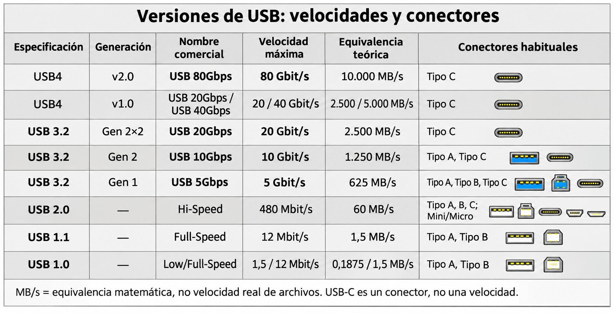

### Thunderbolt

**Thunderbolt** es una tecnología de conexión de alta velocidad desarrollada por Intel en colaboración con Apple y presentada en 2011. Permite transmitir datos, vídeo y alimentación eléctrica mediante una única conexión. Desde Thunderbolt 3 utiliza el conector físico USB tipo C.

Sus principales características son:

- **Alta velocidad**: permite conectar unidades de almacenamiento, monitores y otros periféricos con un elevado ancho de banda.
- **Versatilidad**: combina tecnologías como PCI Express y DisplayPort.
- **Alimentación eléctrica**: puede suministrar energía y cargar dispositivos compatibles.
- **Conexión en cadena** (*daisy chain*): permite conectar varios dispositivos Thunderbolt compatibles a un único puerto del ordenador.

 


### Thunderbolt vs USB tipo C

Desde **Thunderbolt 3**, esta tecnología utiliza el mismo conector físico que **USB tipo C**. Sin embargo, no todos los puertos USB-C admiten Thunderbolt.

- **USB-C** define la forma física del conector, pero no determina por sí solo la velocidad ni las funciones disponibles.
- **USB4** es un estándar de comunicación basado en tecnología de Thunderbolt 3. Sus versiones alcanzan hasta 80 Gbit/s.
- **Thunderbolt 4 y 5** utilizan USB-C y establecen requisitos mínimos de rendimiento, compatibilidad y funciones mediante certificación.

| **Versión** | **Velocidad máxima** | **Conector** |
|---|---:|---|
| Thunderbolt 1 | 10 Gbit/s | Mini DisplayPort |
| Thunderbolt 2 | 20 Gbit/s | Mini DisplayPort |
| Thunderbolt 3 | 40 Gbit/s | USB-C |
| Thunderbolt 4 | 40 Gbit/s | USB-C |
| Thunderbolt 5 | 80 Gbit/s | USB-C |


### Audio analógico

Los conectores de audio son un estándar **analógico** que utilizan todas las placas base a través de sus tarjetas de sonido:

- 🟠 **Naranja**: Conector de salida de los altavoces centrales y del amplificador de graves. Configuración de audio 5.1/7.1 canales. 
- ⬛**Negro**: Conector de salida de los altavoces traseros. Configuración de audio de 4/5.1/7.1 canales.
- **Gris**: Conector de salida de los altavoces laterales. Configuración de audio de 7.1 canales.
- 🟢**Verde**: Conector de salida de línea. Es el conector de salida de **línea predeterminado**. Utiliza este conector de audio para unos auriculares, etc.
- 🔴**Rosa**: Conector de entrada de micrófono. Es el conector de entrada de **micrófono predeterminado**.
- 🔵**Azul**: Conector de entrada de línea para fuentes de audio externas.


### VGA

El conector **VGA** *(Video Graphics Array)* es un puerto **analógico** de salida de vídeo.

- El puerto y el cable suelen ser de color azul y constan de tres hileras con un total de 15 pines.
- Se encontraba en numerosas tarjetas gráficas, monitores y otros dispositivos de vídeo.
- Puede alcanzar aproximadamente **2048 × 1536 píxeles**, aunque la resolución depende del dispositivo.
- Al ser una transmisión analógica, la calidad de imagen depende del cable, su longitud y las interferencias electromagnéticas.
- Es una tecnología heredada, sustituida progresivamente por conexiones digitales como HDMI y DisplayPort.

 

### DVI

El conector **DVI** *(Digital Visual Interface)* apareció con la expansión del vídeo digital en 1999. 

Existen dos variantes principales:

- **DVI-D**: transmite únicamente vídeo digital.
- **DVI-I**: admite señales analógicas y digitales.

Las conexiones digitales DVI pueden funcionar en 2 modalidades, habitualmente hasta 1920 × 1200 a 60 Hz o hasta 2560 × 1600 a 60 Hz, permitiendo también resoluciones menores.

DVI transmite principalmente vídeo, sin audio de forma estándar. Actualmente es una conexión heredada, sustituida progresivamente por HDMI y DisplayPort.

 

### HDMI

**HDMI** (*High-Definition Multimedia Interface*) es una interfaz digital introducida en 2002 que permite transmitir audio y vídeo mediante un único cable, sin conversiones analógicas. Se utiliza para conectar ordenadores, monitores, televisores, videoconsolas y otros dispositivos multimedia.


Sus principales características son:

- **Audio y vídeo digital** de alta calidad mediante un solo cable.
- **Alta resolución**: las versiones modernas admiten 4K, 8K y resoluciones superiores, además de elevadas frecuencias de refresco.
- **Protección de contenidos** mediante HDCP en determinados contenidos digitales.
- **Evolución del ancho de banda**: HDMI 2.1 alcanza 48 Gbit/s y HDMI 2.2 amplía el máximo hasta 96 Gbit/s.

  

### DisplayPort

**DisplayPort** es una interfaz digital de audio y vídeo desarrollada por VESA en 2006 y utilizada principalmente para conectar ordenadores con monitores.

- Admite monitores 4K, 8K y superiores según la versión y el equipo.
- DisplayPort 2.1b alcanza velocidades de hasta **80 Gbit/s**.
- **MST** (*Multi-Stream Transport*) permite conectar varias pantallas compatibles desde una misma salida.
- La sincronización adaptativa ajusta la frecuencia de refresco del monitor para reducir problemas como el *tearing*.
- Puede utilizarse mediante USB-C con DisplayPort Alt Mode y conectarse a HDMI, DVI o VGA mediante adaptadores adecuados.

  

### Puerto RJ45

El conector **RJ45** es el más utilizado para conectar ordenadores y otros dispositivos a redes Ethernet mediante cables de par trenzado.

- Dispone de ocho contactos eléctricos para los cuatro pares de hilos del cable.
- Se utiliza con categorías como Cat 5e, Cat 6 y Cat 6A.
- Permite conexiones de 100 Mbit/s, 1 Gbit/s, 2,5 Gbit/s, 5 Gbit/s y 10 Gbit/s según el cableado y los dispositivos.
- Los conductores se organizan habitualmente siguiendo los esquemas T568A o T568B.
- La longitud máxima habitual de un canal Ethernet de cobre es de 100m.

 

-----

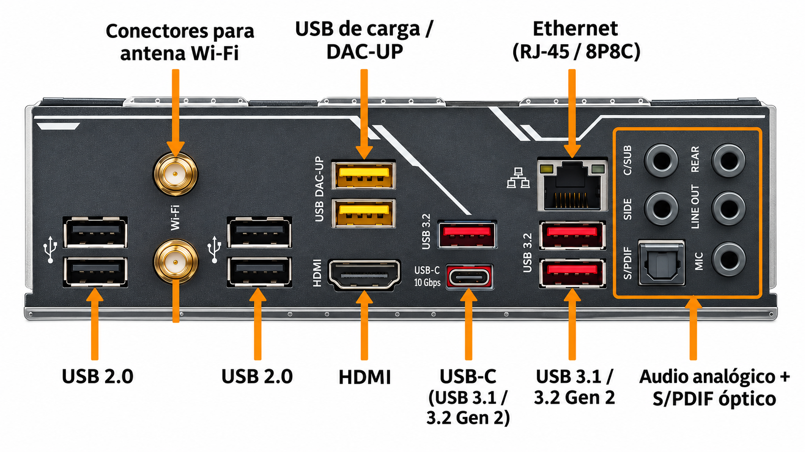

## Tarjeta gráfica

```note
La GPU (Graphics Processing Unit) de una tarjeta gráfica es un procesador especializado en realizar numerosas operaciones matemáticas en paralelo (normalmente en coma flotante), especialmente las necesarias para generar gráficos 2D y 3D.
```

Una **tarjeta gráfica** es el dispositivo hardware que incorpora una GPU junto con otros componentes, como memoria gráfica (VRAM), refrigeración y circuitería de alimentación. La GPU también puede estar integrada en el procesador o SoC.

Hoy en día, las GPU modernas son **procesadores masivamente paralelos**, con **miles de núcleos** capaces de ejecutar muchas operaciones simultáneamente.

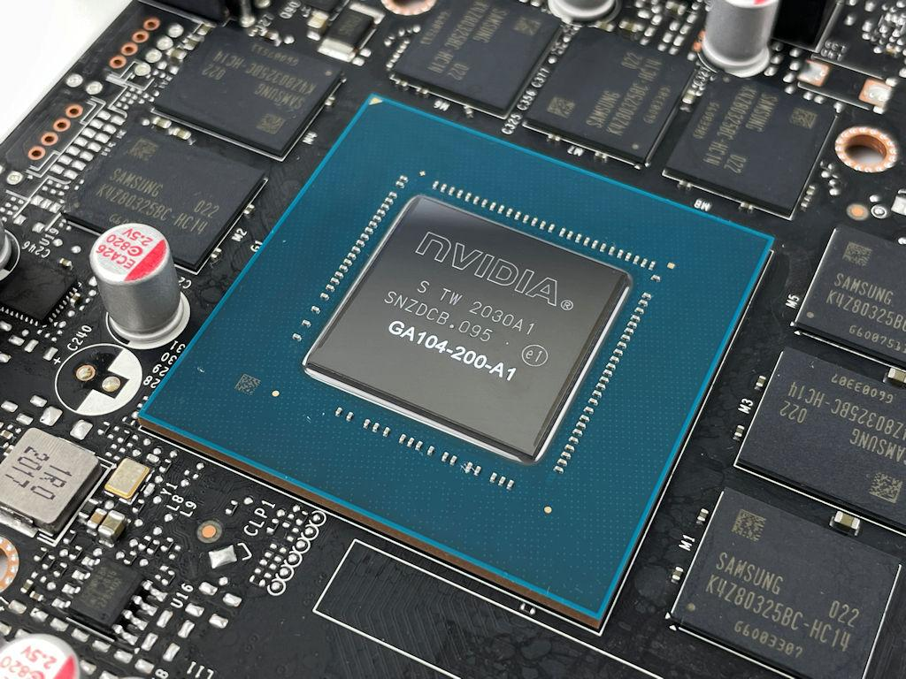

Esto las hace extremadamente eficientes para:
- Renderizar gráficos en videojuegos y animaciones 3D.
- Procesar imágenes y vídeo.
- Realizar cálculos científicos y simulaciones.
- Ejecutar tareas de inteligencia artificial (IA) y aprendizaje automático.

Esta última capacidad de realizar cálculos no relacionados directamente con los gráficos se conoce como **GPGPU (General-Purpose GPU Computing)**.

### Arquitectura paralela

Las GPU están diseñadas para ejecutar un gran número de operaciones simultáneamente, aprovechando una arquitectura con numerosas unidades de procesamiento que trabajan en paralelo.

A diferencia de las CPU, que priorizan la ejecución rápida de tareas variadas y complejas, las GPU están optimizadas para procesar grandes volúmenes de datos mediante operaciones similares.


| **CPU** | **GPU** |
|---|---|
| Menor número de núcleos, generalmente más complejos | Gran cantidad de unidades de ejecución |
| Optimizada para baja latencia | Optimizada para alto rendimiento global (*throughput*) |
| Adecuada para tareas variadas y con dependencias | Adecuada para operaciones masivamente paralelas |
| También ejecuta tareas en paralelo | Ejecuta numerosos hilos agrupados y coordinados |


Las GPU están diseñadas para ejecutar un gran número de operaciones simultáneamente. A diferencia de las CPU, que priorizan la ejecución rápida de tareas variadas y complejas, las GPU procesan grandes volúmenes de datos aplicando operaciones similares.

### Flujo de trabajo

Al igual que vimos en la CPU, veremos el flujo de instrucciones y datos en la GPU que en realidad parte de la GPU y la memoria:

1.  Se preparan y **copian los datos** a procesar de la  memoria de la CPU a la de la GPU.
2.  La CPU envía las **instrucciones** de dibujado del programa para que sean procesadas por la GPU.
3.  Se **ejecutan** las instrucciones en la GPU mediante hilos del kernel en paralelo repartidos entre los diferentes cores.
4.  Devuelve datos resultantes procesados a la memoria principal o se quedan en la memoria de la gráfica para usarse posteriormente.


### Tarjetas gráficas integradas (iGPU)

Las **GPU integradas (iGPU)** se encuentran incorporadas en el procesador o SoC, compartiendo recursos con la CPU. Actualmente están presentes en numerosos procesadores de Intel, AMD y dispositivos basados en ARM.


Sus principales características son:
- Utilizan generalmente la **RAM del sistema** en lugar de VRAM independiente.
- Consumen menos energía que una GPU dedicada.
- Son adecuadas para ofimática, navegación, reproducción de vídeo y, según el modelo, videojuegos y aplicaciones multimedia.
- Reducen el espacio ocupado y facilitan la comunicación entre CPU y GPU. En ciertos diseños evitan algunas copias de datos entre memorias.
 
### Tarjetas gráficas dedicadas (dGPU)

Las tarjetas gráficas dedicadas se identifican a simple vista en una placa. Son tarjetas de vídeo que tienen su propia GPU, memoria gráfica llamada **VRAM**, salidas de vídeo y sistema de refrigeración y que se conectan a la placa base a través del puerto PCI-Express (antiguamente era el AGP). En algunos portátiles, generalmente están integradas en la placa.

Proporcionan un rendimiento muy superior a los gráficos integrados, pero también son mucho más caras y su consumo energético suele ser elevado.

Las principales familias de GPU dedicadas para ordenadores personales incluyen *NVIDIA GeForce*, *AMD Radeon* e *Intel Arc*.

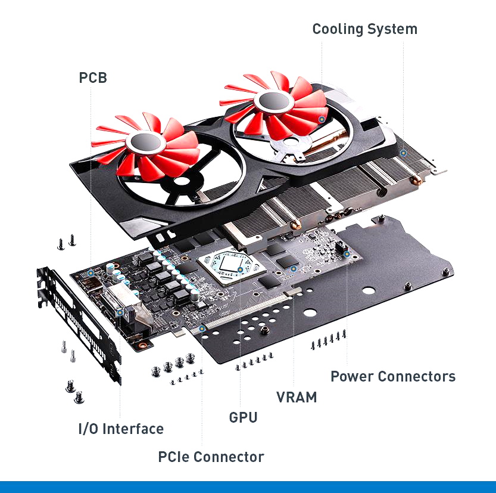 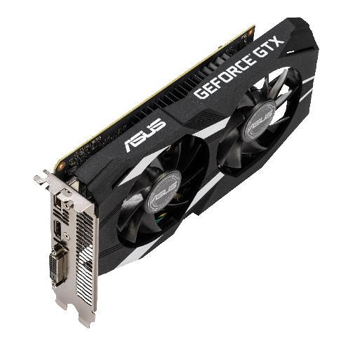

### Características

Al igual que con las CPU, sus principales **características** son:

- Arquitectura y generación.
- Núcleos o unidades de procesamiento.
- Frecuencia de funcionamiento.
- Tecnología de fabricación.
- Memoria gráfica VRAM.
- Refrigeración y consumo energético.
- Configuraciones multi-GPU.
- Resolución de salida.
- Compatibilidad con APIs gráficas.
- Tecnologías adicionales de renderizado, vídeo e inteligencia artificial.

### Arquitectura y generación de una GPU

La **arquitectura de una GPU** define cómo están diseñadas y organizadas sus unidades de procesamiento, memorias caché y demás componentes internos.

Los fabricantes desarrollan nuevas generaciones de arquitecturas para mejoras como mayor rendimiento, mejor eficiencia energética y nuevas funcionalidades como trazado de rayos (ray tracing), generación de frames e inteligencia artificial.

Cada fabricante utiliza sus propias arquitecturas. Algunos ejemplos son:

- **NVIDIA**: Ampere, Ada Lovelace y Blackwell.
- **AMD**: RDNA 2, RDNA 3 y RDNA 4.
- **Intel**: Xe-HPG y Xe2, también denominada Battlemage.

> 👉 Una arquitectura más reciente no garantiza que cualquier GPU de esa generación supere a todos los modelos anteriores.


### Núcleos (cores) de la gráfica

Las GPU modernas incorporan numerosas **unidades de procesamiento** que trabajan en **paralelo**. Ejecutan las operaciones matemáticas necesarias para generar gráficos, procesar imágenes o resolver cálculos complejos.

Los fabricantes utilizan diferentes denominaciones:

- **NVIDIA**: núcleos CUDA agrupados en *Streaming Multiprocessors* (SM).
- **AMD**: *Stream Processors* agrupados en *Compute Units* (CU).

Existen núcleos especializados en Ray Tracing y otros en IA u operaciones matriciales.

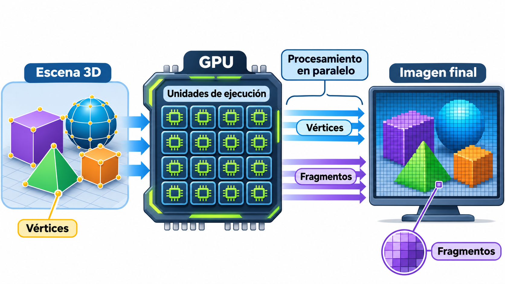

Para generar una imagen 3D, la GPU distribuye el procesamiento de **vértices** y **fragmentos** de imagen entre sus unidades de ejecución para realizar numerosos cálculos de forma simultánea.


### Memoria gráfica VRAM

La **VRAM** es la memoria que utiliza la GPU para almacenar temporalmente texturas, imágenes, modelos 3D y otros datos necesarios para sus cálculos. 

Sus principales características son:

- **Capacidad (GB)**: cantidad de datos que puede almacenar.
- **Tipo de memoria**: destacan *GDDR6* y *GDDR7*, mientras *HBM* se utiliza principalmente en aceleradores profesionales.
- **Ancho de banda (GB/s)**: cantidad de datos que pueden transferirse entre la GPU y la VRAM por segundo.

> ⚠️ Una mayor cantidad de VRAM no implica necesariamente mayor rendimiento. También influyen su velocidad, el ancho de banda y la arquitectura de la GPU.

### Resolución de salida

Existe una amplia gama de **resoluciones** (medidas en *pixels* de alto por largo) de salida que una gráfica puede generar de salida hacia un monitor o pantalla.

Las más conocidas son:

-   **VGA** (SD): *640x480 pixels*
-   **SVGA**: *800x600 pixels*
-   **720p** (HD): *1280x720* pixels
-   **1080p** (FHD): *1920x1080 pixels*
-   **2K**: *2048 x 1080 pixels*
-   **1440p** (QHD): *2560 x 1440*
-   **4K**: *3840 x 2160 pixels*


> También existe la frecuencia de refresco (Hz), es decir, número de veces por segundo que un monitor conectado a una gráfica puede actualizar la imagen recibida.


### Compatibilidad con APIs para gráficos

Una **API** (*Application Programming Interface*) es un conjunto de definiciones y protocolos que se utiliza para desarrollar e integrar el motor gráfico de dibujado de gráficos en cualquier equipo. Partimos de varias APIs en el mercado:

- **DirectX**: desarrollada por Microsoft. DirectX 12 se utiliza en Windows y Xbox, especialmente en videojuegos.
- **OpenGL**: estándar abierto y multiplataforma utilizado en Windows, macOS y Linux. Se emplea en CAD, realidad virtual y motores gráficos. Su versión más reciente es OpenGL 4.6.
- **Vulkan**: API multiplataforma de bajo nivel anunciada por Khronos Group en 2015 para gráficos 3D y cómputo.
- **Metal**: API optimizada para el ecosistema de Apple. La presentación sitúa su versión actual en Metal 4.

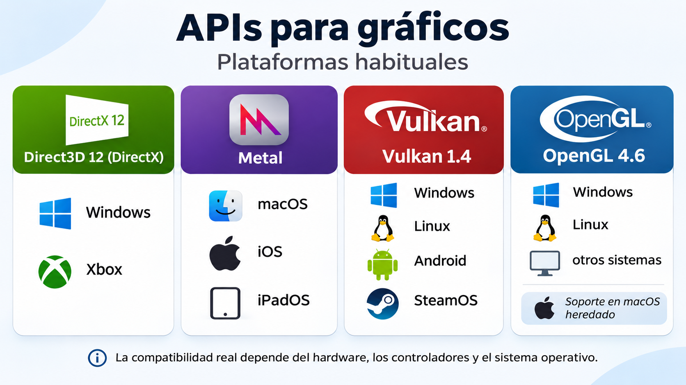

### Tecnologías adicionales

Las GPU modernas incorporan tecnologías especializadas para mejorar la calidad gráfica, aumentar el rendimiento y acelerar tareas multimedia:

- **Ray tracing**: simula el comportamiento de la luz para generar reflejos, sombras e iluminación más realistas.
- **Super Resolution**: renderiza a una resolución inferior y reconstruye la imagen a una resolución superior para reducir la carga de trabajo.
- **Frame Generation**: genera fotogramas intermedios mediante algoritmos que pueden utilizar inteligencia artificial.
- **Aceleración de vídeo**: emplea unidades especializadas para codificar y decodificar H.264, H.265/HEVC o AV1.

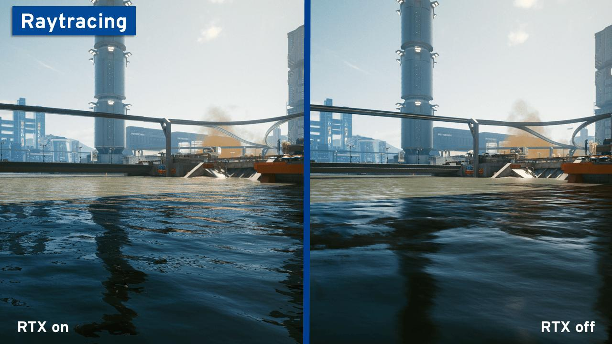

| **Fabricante** | **Tecnología** | **Aplicación principal** |
|---|---|---|
| NVIDIA | DLSS | Reescalado, reconstrucción y generación de fotogramas mediante IA |
| AMD | FSR | Reescalado y generación de fotogramas con técnicas que varían según la generación |

 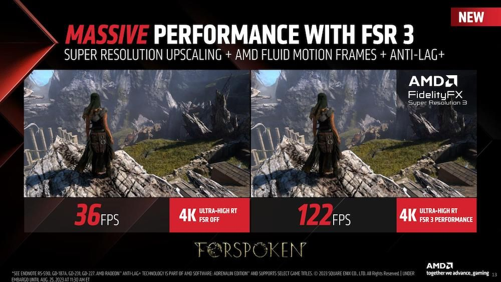

## Unidades de almacenamiento

Las **unidades de almacenamiento permanente** o **memoria secundaria** almacenan información en grandes cantidades para que persista y no se pierda.
Veremos diversos dispositivos como Discos Duros, discos SSD, memorias flash y dispositivos ópticos como el DVD o el BluRay (BD).
Su relación con el resto de dispositivos es crítica para garantizar una capacidad y rendimiento de datos en el sistema, especialmente en servidores de datos.


El **precio por GB** de los medios de almacenamiento secundario ha caído muchísimo a lo largo de los años, desde los 10 millones de dólares por GB de 1956 a los 3 céntimos de dólar actuales. Los medios magnéticos son los medios de almacenamiento masivo de información por excelencia. Sus principios tecnológicos del almacenamiento de tipo magnético apenas han variado aunque se acercan a su límite físico en cuanto a capacidad de almacenamiento, velocidades o tamaños.


### Discos duros (HDD)

```note
Los **dispositivos magnéticos** son aquellos dispositivos de almacenamiento de datos en los que se utilizan propiedades magnéticas de los materiales para almacenar la información digital.
```
Entre ellos destacan los **discos duros (HDD)** y las cintas magnéticas, que todavía se utilizan para copias de seguridad y archivado de grandes volúmenes de información.

Los discos duros son dispositivos de almacenamiento que combinan componentes mecánicos y electrónicos para guardar y recuperar información mediante grabación magnética.

En su interior disponen de platos giratorios recubiertos de material magnético, cabezales de lectura/escritura y una controladora electrónica.


 


### Discos en estado sólido (SSD)

```note
Los discos **SSD** (Solid State Drive) a diferencia de los discos duros tradicionales, son unidades de almacenamiento puramente electrónicas que utilizan memoria en estado sólido para almacenar la información.
```

Estas unidades contienen en su interior:
- **Memoria NAND flash**: constituye la base del almacenamiento.
- **Memoria caché DRAM**: algunos SSD la incorporan para mejorar el rendimiento.
- **Controlador**: gestiona la lectura, la escritura, la corrección de errores y el desgaste de las celdas.


La **memoria NAND** es un tipo de memoria Flash cuya denominación hace referencia al tipo de puerta lógica booleana que usa y que ya conocemos.

Cuando se comenzó a fabricar, este tipo de memoria podía ser de tipo NOR o NAND, según el tipo de transistor que se empleara en su construcción. Aunque las puertas NOR presentaban ciertas ventajas, la memoria fabricada con transistores **NAND** es más fácil de producir, más barata y con densidades mayores, así que ese es el tipo de memoria Flash que empleamos en la actualidad en almacenamiento, salvo en BIOS donde suele usarse la NOR.

La memoria NAND se organiza en páginas y bloques. Los datos se leen y escriben por páginas, mientras que el borrado se realiza por bloques completos.


El **rendimiento** de estas unidades SSD se mide principalmente por su capacidad para realizar operaciones de entrada y salida de datos con rapidez y eficiencia:

- **IOPS** (*Input/Output Operations Per Second*): número de operaciones de lectura o escritura por segundo. Resultan especialmente relevantes en accesos aleatorios de sistemas operativos o bases de datos.
- **Velocidad secuencial**: cantidad de datos que puede transferir por segundo cuando la información se almacena de forma consecutiva. Es importante al copiar archivos grandes.
- **Latencia**: tiempo que tarda el SSD en responder a una operación, normalmente medido en microsegundos.
- **Memoria caché**: algunos SSD utilizan DRAM o mecanismos de caché SLC para mejorar el rendimiento.

👉 El rendimiento real depende del tipo de acceso, la interfaz, el controlador y las características de la memoria NAND.


### Tecnología de celdas SSD 

La tecnología de celdas SSD indica cuántos **bits de información** puede almacenar cada celda, lo que afecta directamente a la velocidad, durabilidad y precio.


### Unidades M.2 NVMe

Las unidades SSD NVMe utilizan un protocolo diseñado para aprovechar el rendimiento y el paralelismo de PCI Express, por lo que ofrecen mayores velocidades y menores latencias que los SSD SATA tradicionales.


Conviene distinguir tres conceptos:

- **M.2**: formato físico y conector compacto que permite instalar unidades directamente en la placa base, sin cables de datos ni alimentación.
- **PCI Express (PCIe)**: interfaz de comunicación de alta velocidad que conecta el SSD con el sistema.
- **NVMe** (*Non-Volatile Memory Express*): protocolo optimizado para almacenamiento no volátil que permite gestionar numerosas operaciones simultáneas. No todos los SSD M.2 utilizan NVMe.

Estas unidades aprovechan la baja latencia y el paralelismo de PCI Express para mejorar la transferencia y la eficiencia energética en suspensión.

### Tarjetas de memoria

Las **tarjetas de memoria** son dispositivos de memoria ultraportátiles de pequeño tamaño, con gran capacidad de almacenamiento, bastante resistentes a golpes y de bajo consumo. Las generalmente dispositivos como cámaras, drones y algunos teléfonos móviles como almacenamiento externo.

Entre los formatos de la familia SD se encuentran:

- **SDHC** (*Secure Digital High Capacity*): hasta 32 GB.
- **SDXC** (*Secure Digital eXtended Capacity*): hasta 2 TB.
- **SDUC** (*Secure Digital Ultra Capacity*): más de 2 TB y hasta 128 TB.

Los formatos físicos principales son SD y **microSD**, además del antiguo **miniSD**.

 

Las clasificaciones de velocidad indican la velocidad mínima de escritura secuencial:

| **Clasificación** | **Velocidad mínima** |
|---|---:|
| Class 10 (C10) | 10 MB/s |
| U1 | 10 MB/s |
| U3 | 30 MB/s |
| V30 | 30 MB/s |
| V60 | 60 MB/s |
| V90 | 90 MB/s |

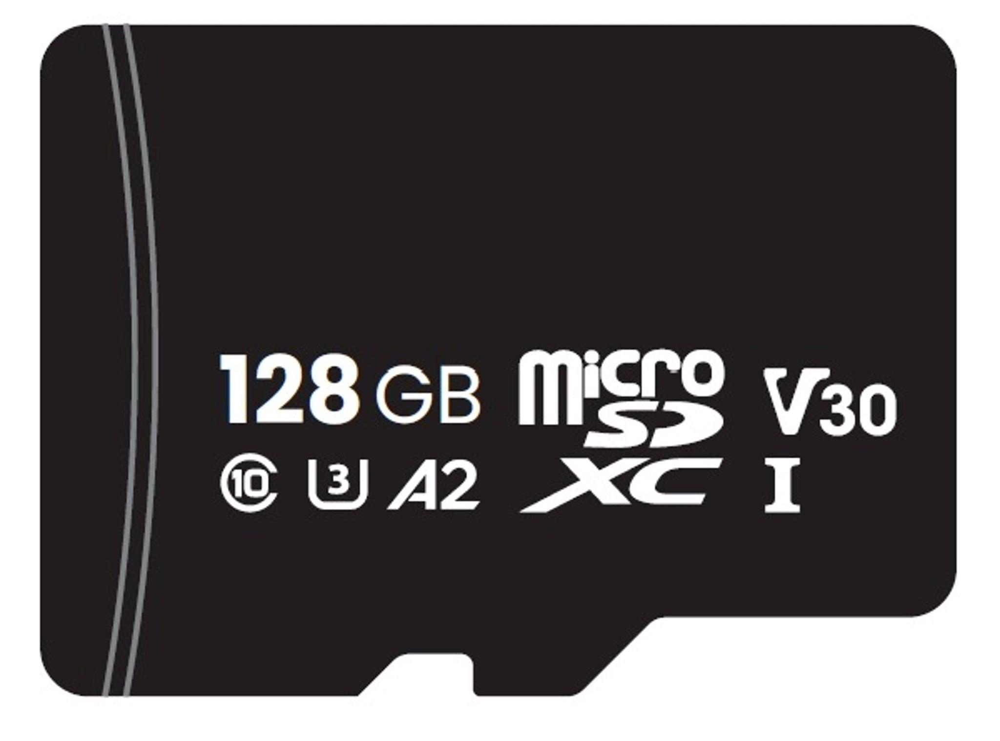


### Dispositivos ópticos

Los **dispositivos ópticos** (CD, DVD y BluRay) han perdido su protagonismo, cuando suponían el medio preferido de instalación para los sistemas operativos, videojuegos y programas con un soporte de almacenamiento con mucha capacidad y a un coste por bit reducido.

A diferencia de los medios magnéticos de la época, tenían la ventaja de que el soporte además de muy barato, con unos cuidados básicos, podía durar muchos años sin que la información se degradase tanto con el paso del tiempo.


La **capacidad de almacenamiento** de cada medio óptico depende de si admite una o dos capas o utiliza doble capa a la hora de grabar y leer luego los datos:

| **Tipo de disco**       | **Capacidad** | **Capacidad audio** | **Capacidad video** |
|-------------------------|---------------|---------------------|---------------------|
| CD, CDR                 | 700 MB        | 1h 18min            | 15 min              |
| DVD, DVDR               | 4.7 GB        | 9h 30min            | 2h 15min            |
| DVD 1 cara, doble capa  | 8.5 GB        | 17h 30min           | 4h                  |
| DVD 2 caras             | 9.4 GB        | 19h                 | 4h 30min            |
| DVD 2 caras, doble capa | 17 GB         | 35h                 | 8h                  |
| Blu-Ray                 | 25 GB         | 45h                 | 12h                 |
| Blu-Ray doble capa      | 50 GB         | 90h                 | 24h                 |


### Evolución de los medios de almacenamiento

La evolución de los medios de almacenamiento ha aumentado la capacidad y la velocidad al tiempo que ha reducido el tamaño físico y el coste por unidad de información.

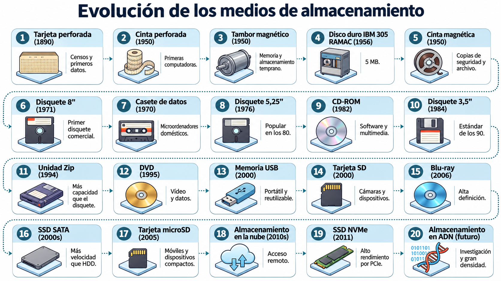

## Tarjetas de red

```note
Las tarjetas de red se utilizan para conectar ordenadores entre sí con la finalidad de compartir recursos (por ejemplo, impresoras o archivos) y poder formar una red.
```

Las tarjetas de red, adaptadores de red o **NIC** (*Network Interface Card*) permiten conectar un ordenador a una red para intercambiar información y compartir recursos.

Según el tipo de conexión se distinguen:

- **Tarjetas Ethernet**: permiten conexiones cableadas mediante par trenzado con RJ45 o fibra óptica con las interfaces y transceptores correspondientes.
- **Adaptadores Wi-Fi**: permiten conectarse a redes locales inalámbricas mediante ondas de radio.

Pueden estar integradas en la placa base o instalarse mediante PCI Express, módulos M.2 o adaptadores USB.


### Velocidad de las tarjetas de red 

La velocidad depende del estándar, del adaptador y del medio de conexión:

| **Tecnología** | **Velocidad** | **Ejemplo de estándar** | **Medio habitual** |
|---|---:|---|---|
| Ethernet | 10 Mbit/s | 10BASE-T | Par trenzado |
| Fast Ethernet | 100 Mbit/s | 100BASE-TX | Par trenzado |
| Gigabit Ethernet | 1 Gbit/s | 1000BASE-T | Par trenzado |
| Multi-Gigabit | 2,5 Gbit/s | 2.5GBASE-T | Par trenzado |
| Multi-Gigabit | 5 Gbit/s | 5GBASE-T | Par trenzado |
| 10 Gigabit | 10 Gbit/s | 10GBASE-T | Par trenzado |
| 10 Gigabit | 10 Gbit/s | 10GBASE-SR | Fibra óptica |
| 25 Gigabit | 25 Gbit/s | 25GBASE-SR | Fibra óptica |
| 100 Gigabit | 100 Gbit/s | 100GBASE-SR4 | Fibra óptica |

## Periféricos

```note
Los periféricos son dispositivos hardware con los cuales el usuario puede interactuar con el ordenador (teclado, ratón, monitor), almacenar o leer datos y/o programas (dispositivos de almacenamiento o memorias auxiliares),imprimir, etc.
```


Los periféricos se conectan con el ordenador, la CPU y sus componentes, a través de los **puertos** o conectores externos gracias a la **unidad de entrada/salida** ambos vistos en unidades anteriores.

Los periféricos de entrada/salida necesitan un tipo de software especial para comunicarse adecuadamente con el SO llamado **driver.**

Los **periféricos** pueden clasificarse en los siguientes tipos:

-   Periféricos de **entrada**
-   Periféricos de **salida**
-   Periféricos de **almacenamiento**
-   Periféricos de **comunicación**
-   Periféricos **híbridos**

## El monitor o pantalla

El monitor o pantalla de un ordenador es el principal dispositivo de salida (interfaz), que muestra datos o información al usuario.

También puede considerarse un periférico de *Entrada/Salida* si el monitor tiene pantalla táctil o multitáctil, o si se trata de la pantalla de una tablet o smartphone.

La historia de los monitores siempre ha ido muy pareja al de las tarjetas gráficas. Al principio estas sólo podían trabajar con texto y no fue hasta varios años después cuando gracias a las tarjetas CGA consiguen llegar hasta los cuatro colores.

Después se pasó a 16, luego a 256, y a 65536 colores llegando a la actualidad donde cualquier monitor puede mostrar sin problemas unos 17 millones de colores distintos en altas resoluciones y nuevas tecnologías como el HDR.


### Características

Características técnicas subyacentes a un monitor o pantalla:

- Tamaño. 
- Relación de aspecto.
- Resolución
- Luminosidad o brillo
- Profundidad de color
- Contraste (estático y dinámico)
- Tiempo de respuesta
- Tasa de refresco
- Espectro de color
- Angulo de visión
- Conectores
- Ahorro energético


El **tamaño de la pantalla** es la distancia en diagonal de un vértice de la pantalla al opuesto y se mide en pulgadas.


La **proporción** o relación de aspecto es una medida de proporción entre el ancho y el alto de la pantalla, así por ejemplo una proporción de 4:3 (cuatro tercios) significa que por cada 4 píxeles de ancho tenemos 3 de alto, una resolución de 800x600 tiene una relación de aspecto 4:3, sin embargo estamos hablando de la proporción del monitor.


Estas dos medidas describen el tamaño de lo que se muestra por la pantalla, históricamente hasta no hace mucho tiempo y al igual que las televisiones los monitores de ordenador tenían un proporción de 4:3. Posteriormente se desarrollaron estándares para pantallas de aspecto panorámico 16:9 (a veces también de 16:10 o incluso 21:9 ultrapanorámico) hasta entonces solo usado en el cine.


| **Relación de aspecto** | **Anchura** (en píxeles) | **Altura** (en píxeles) | **Descripción**                  | **Pulgadas Monitor** |
|-------------------------|--------------------------|-------------------------|----------------------------------|----------------------|
| **4:3**                 | *640*                    | *480*                   | Definición estándar (SD)         | 14’’                 |
| **16:10**               | *1280*                   | *800*                   | Alta definición (HD)             | 17’’ y 19’’          |
| **16:9**                | *1280*                   | *720*                   | Alta definición (HD)             | 17’’ y 19’’          |
| **16:9**                | *1920*                   | *1080*                  | Alta definición (FHD)            | 24’’,25’’,26’’       |
| **16:9**                | *2560*                   | *1440*                  | 2K (QHD)                         | 27’’, 28’’, 32’’     |
| **16:10**               | *2560*                   | *1600*                  | Wide 2K (WQHD)                   | 27’’, 28’’           |
| **16:9**                | *3840*                   | *2160*                  | Ultra alta definición (UHD) o 4K | 27’’, 32’’, 34’’     |
| **21:9**                | *5120*                   | *2160*                  | Ultra Wide (WUHD)                | 34’’                 |
